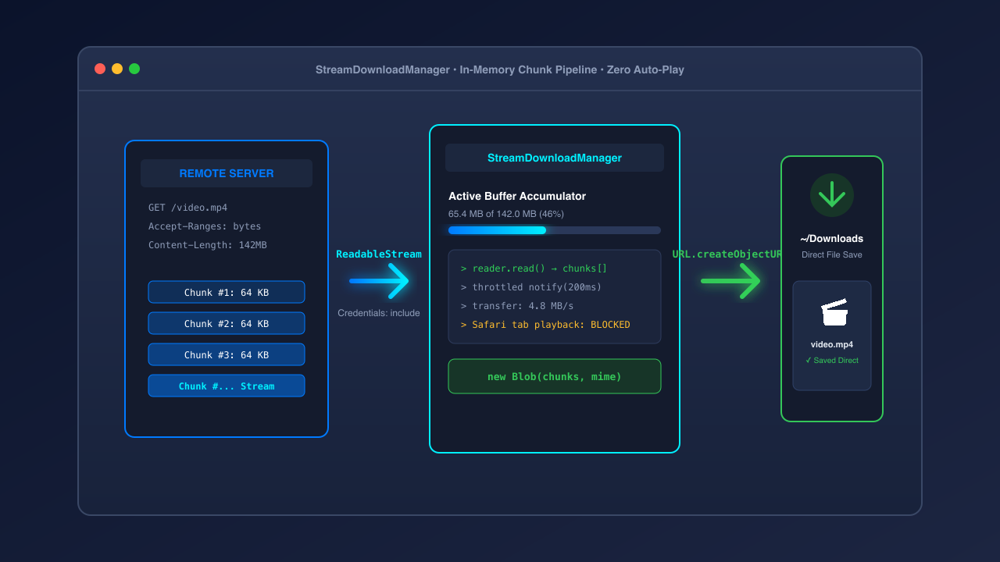
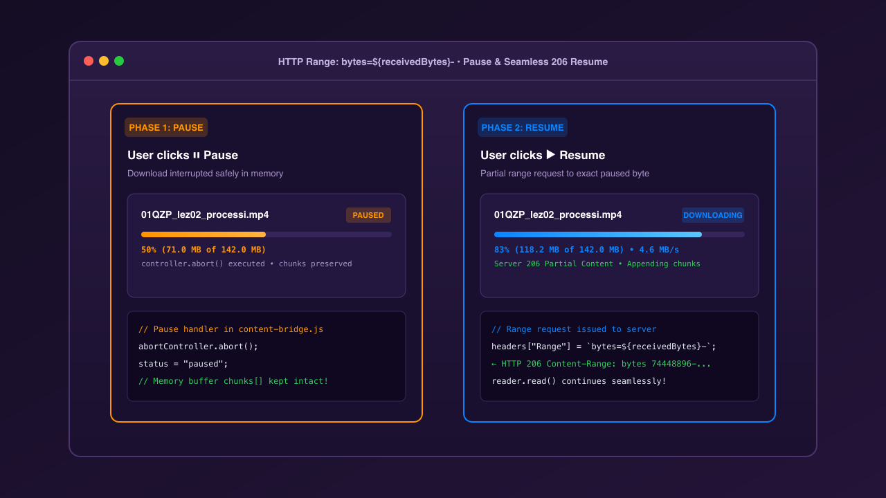
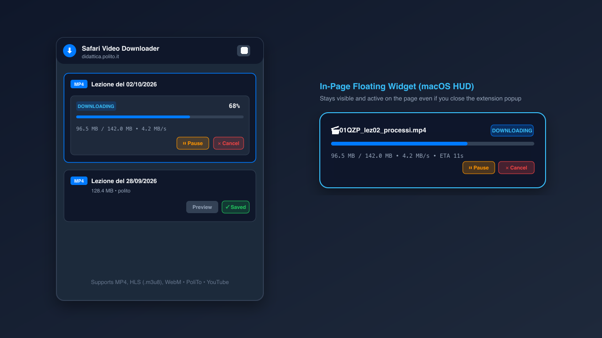
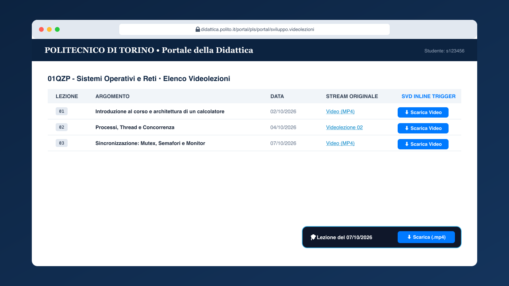
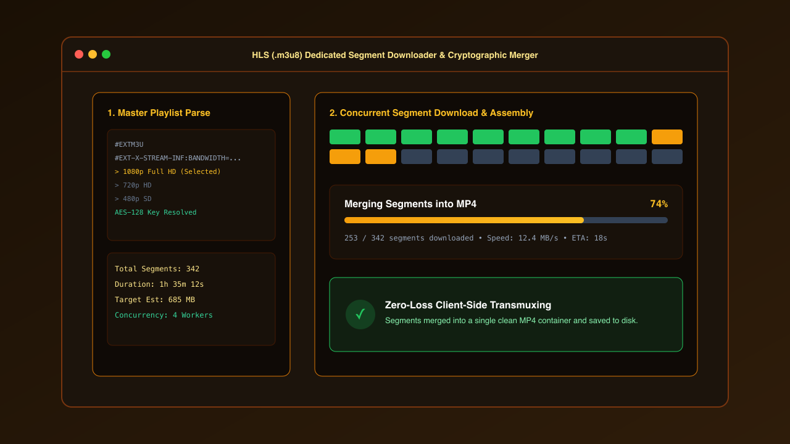
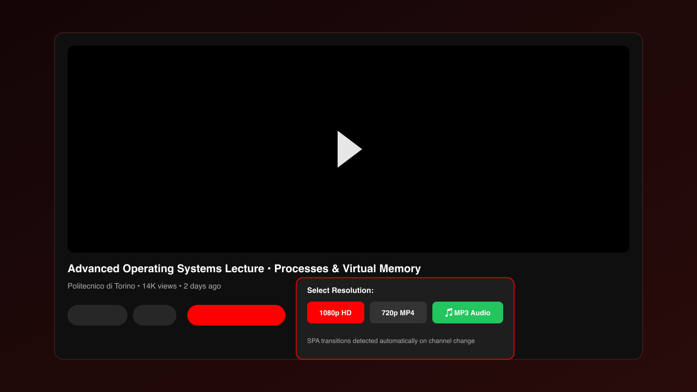
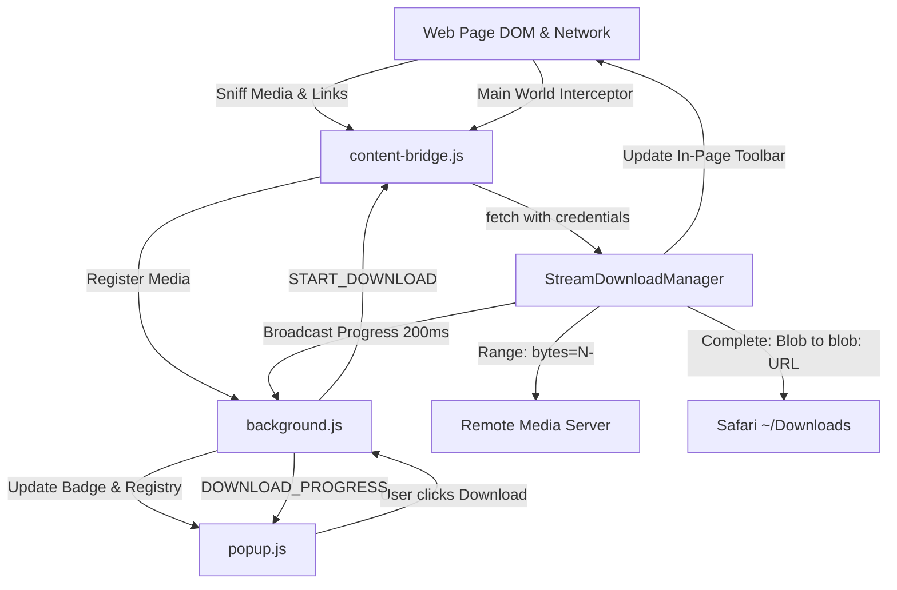

<p align="center">
  
</p>

<h1 align="center">Safari Video Downloader</h1>

<p align="center">
  <b>A modern, high-performance Manifest V3 Safari extension to detect, stream, and download videos with real-time progress tracking, pause/resume, and zero unwanted video playback.</b>
</p>

<p align="center">
  <a href="#features"></a>
  <a href="#features"></a>
  <a href="#features"></a>
  <a href="#features"></a>
  <a href="#features"></a>
</p>

---

## Table of Contents

- [General Concept](#general-concept)
- [Key Features with Visual Walkthroughs](#key-features-with-visual-walkthroughs)
  - [1. Chunked Streaming Engine & Blob Downloads](#1-chunked-streaming-engine--blob-downloads)
  - [2. Stop (Pause) & Resume via HTTP Range](#2-stop-pause--resume-via-http-range)
  - [3. Interactive Progress Toolbars (Popup & In-Page)](#3-interactive-progress-toolbars-popup--in-page)
  - [4. Portale della Didattica (PoliTo) Integration](#4-portale-della-didattica-polito-integration)
  - [5. Client-Side HLS (.m3u8) Stream Merger](#5-client-side-hls-m3u8-stream-merger)
  - [6. YouTube Video & Audio Downloader](#6-youtube-video--audio-downloader)
- [Architecture Overview](#architecture-overview)
- [One-Click Automated Installation](#one-click-automated-installation)
- [Manual Installation in Safari](#manual-installation-in-safari)
- [Testing & Verification](#testing--verification)
- [Contributing & License](#contributing--license)

---

## General Concept

Modern university learning management systems (such as Politecnico di Torino's *Portale della Didattica*) and streaming platforms often restrict direct media downloads, forcing lectures to stream through embedded web players or omitting direct download anchors. 

When users attempt to save videos via Safari by clicking direct links, Safari's WebKit engine traditionally navigates away from the page to open a raw media player tab and stream the video instead of saving it to disk, interrupting study workflows.

**Safari Video Downloader** solves this problem cleanly. It acts as an in-browser media interceptor and background streaming manager:
1. It sniffs video elements, hyperlinks, and network media requests (`.mp4`, `.m3u8`, `.webm`).
2. It fetches binary streams in memory using `ReadableStream` chunks while sending session credentials and cookies.
3. It visualizes live percentage (`0%` to `100%`), size, and transfer speed.
4. It converts completed chunks into a local `Blob` download, prompting Safari to save the file straight to your `~/Downloads` folder without navigating or playing the video.

---

## Key Features with Visual Walkthroughs

### 1. Chunked Streaming Engine & Blob Downloads

<p align="center">
  
</p>

- Powered by `StreamDownloadManager` in [`content/content-bridge.js`](content/content-bridge.js).
- Reads binary buffers progressively via `ReadableStreamDefaultReader`.
- Automatically inherits session credentials (`credentials: "include"`), enabling seamless downloads behind university single sign-on (SSO) Shibboleth and student portals.
- **Zero unwanted playback**: Videos are never opened or played in Safari upon download. Media is converted in memory into a native `Blob`, triggering a local `blob:` URI save that Safari's WebKit engine routes directly to `~/Downloads`.

---

### 2. Stop (Pause) & Resume via HTTP Range

<p align="center">
  
</p>

- **Stop (Pause)**: Safely interrupts the active stream via `AbortController.abort()` while keeping all received chunks and byte offsets in memory.
- **Resume**: Re-opens the connection using HTTP partial content headers (`Range: bytes=${receivedBytes}-`).
- Servers answering with `206 Partial Content` resume instantaneously without re-downloading existing chunks. If a server does not support byte ranges (answers with `200 OK`), the engine automatically resets to byte 0 to preserve file integrity.

---

### 3. Interactive Progress Toolbars (Popup & In-Page)

<p align="center">
  
</p>

- **Extension Popup Toolbar**:
  - Real-time percentage counter (`0%` to `100%`) with smooth animated fill bar.
  - Downloaded vs. total bytes (`45.2 MB / 120.0 MB`) and transfer speed (`3.4 MB/s`).
  - Interactive controls: **⏸ Pause**, **▶ Resume**, and **✕ Cancel**.
- **In-Page Floating Widget**:
  - A frosted-glass macOS HUD rendered at the bottom-right of the web page.
  - Allows you to monitor, pause, or resume your download even after closing the extension popup.
- **Background Synchronization**:
  - Download states persist in [`background.js`](background.js); closing and reopening the popup restores active toolbars instantly.

---

### 4. Portale della Didattica (PoliTo) Integration

<p align="center">
  
</p>

- Automatically recognizes `didattica.polito.it` lecture catalogues.
- Replaces generic titles (`"Portale della Didattica - Pagina del Corso"`) with the actual lecture name and date (e.g. `Lezione del 02/10/2026`).
- Injects a convenient inline **"Scarica Video"** button next to each table link.
- Chronological ordering: newly selected or clicked lectures are placed at the bottom, auto-scrolling to show the latest entry.
- Click any title in the popup to rename it before saving.

---

### 5. Client-Side HLS (.m3u8) Stream Merger

<p align="center">
  
</p>

- Standalone merger application in [`downloader/hls-downloader.html`](downloader/hls-downloader.html).
- Parses `.m3u8` master playlists and segment lists.
- Concurrently fetches `.ts` transport stream segments (4 concurrent workers).
- Supports AES-128 cryptographic decryption via Web Crypto API (`window.crypto.subtle`).
- Merges chunks client-side into a unified `.mp4` container.

---

### 6. YouTube Video & Audio Downloader

<p align="center">
  
</p>

- Injects a native **"⬇ Download"** pill button directly onto YouTube's action bar.
- Offers instant format downloads: **1080p Full HD**, **720p HD**, and **MP3 Audio**.
- Listens to YouTube Single Page Application (SPA) navigation events (`yt-navigate-finish`, `popstate`) so switching videos updates metadata without page reloads.

---

## Architecture Overview



---

## One-Click Automated Installation

A setup script is included in the root directory that configures Safari's developer settings, installs the extension files, and launches the verification environment.

### Run in Terminal:
```bash
curl -fsSL https://raw.githubusercontent.com/Beccaceci/safari-video-downloader/main/install.sh | bash
```
*Or locally after cloning:*
```bash
git clone git@github-beccaceci:Beccaceci/safari-video-downloader.git
cd safari-video-downloader
./install.sh
```

**What the installer does automatically:**
1. Enables Safari's Developer Menu via macOS system defaults:
   - `IncludeDevelopMenu = true`
   - `WebKitDeveloperExtrasEnabledPreferenceKey = true`
2. Deploys the extension assets to `~/Library/Application Support/SafariVideoDownloader`.
3. Opens Safari directly to the integrated test suite.
4. Guides you through the two quick one-time toggles in Safari's preferences.

---

## Manual Installation in Safari

1. **Enable Developer Menu**:
   - Open **Safari > Settings (⌘,) > Advanced**.
   - Check **"Show features for web developers"** (or "Show Develop menu in menu bar").
2. **Allow Unsigned Extensions**:
   - In Safari's menu bar, click **Develop > Allow Unsigned Extensions** (enter your macOS password).
3. **Turn on the Extension**:
   - Open **Safari > Settings > Extensions**.
   - Check the box next to **Safari Video Downloader**.

---

## Testing & Verification

The repository includes a comprehensive test suite in [`test/`](test/):

- **Mock Portale della Didattica**: Run `./scripts/open-in-safari.sh` to test lecture detection, link renaming, and inline button placement.
- **YouTube Mock**: Run `./scripts/open-youtube-test.sh` to test YouTube pill injection and quality selectors.
- **Automated HTTP 206 Stream Test**:
  ```bash
  node test/test-download-stream.js
  ```
  *Spins up an HTTP server, streams 1 MB of binary data, tests abort/pause, resumes from byte offset with `Range: bytes=...`, and verifies binary hash integrity.*

---

## Contributing & License

Contributions, feature requests, and bug reports are welcome via GitHub issues and pull requests.

Distributed under the **MIT License**. See `LICENSE` for details.
